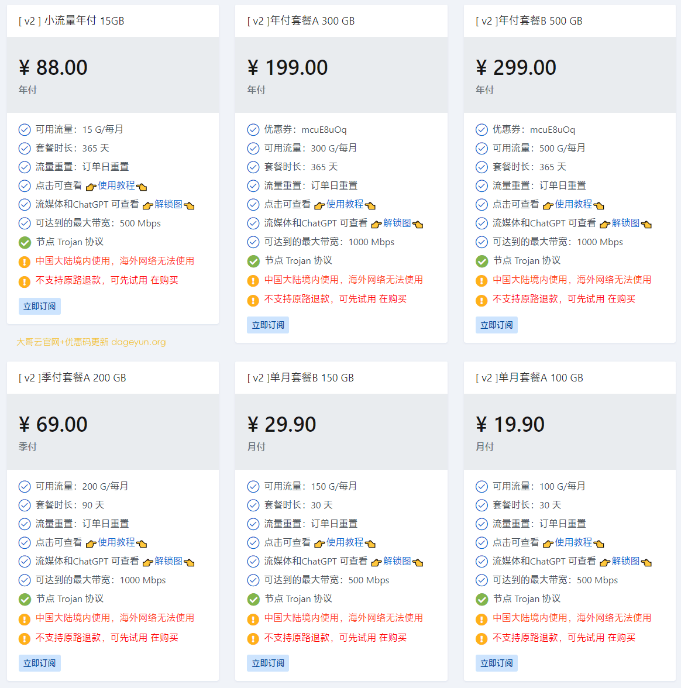

# 大哥云官网地址

大哥云官网永久地址：[dageyun.com](https://dageyun.org/out/dage)

[大哥云直连地址1](https://aff02.dgy02.com//#/register?code=3jP2Cuqu)

[大哥云直连地址2](https://dageyun.org/out/dage)

## 简介

大哥云加速器，价格便宜，低至￥7+一个月，线路带宽充裕不拥挤。

支持SSR、V2ray节点，国内中转节点，解锁流媒体，CN2/BGP隧道中转和IPLC国际专线节点。

## 大哥云优惠码

大哥云优惠码：

大哥云加速2025五一特惠包年8折优惠代码：[dgy51](https://dageyun.org/out/dage)

## 大哥云怎么样？

大哥云VPN加速器，提供Trojan协议及V2Ray协议加速节点，支持一键导入支持Clash、Shadowrocket、小火箭等app。

## 大哥云优惠套餐

| 大哥云 | 付款周期 | 价格 | 每月流量 | 同时在线 |
| --- | --- | --- | --- | --- |
| VIP1 小流量 | 按年付 | 88.00 | 15 GB | 无限制 |
| 套餐A | 按月付 | 19.90 | 100 GB | 无限制 |
| 套餐A | 按季付 | 69.00 | 200 GB | 无限制 |
| 套餐A | 按年付 | 199.00 | 300 GB | 无限制 |
| 套餐B | 按月付 | 29.90 | 150 GB | 无限制 |
| 套餐B | 按季付 | 129.00 | 300 GB | 无限制 |
| 套餐B | 按年付 | 299.00 | 500 GB | 无限制 |

